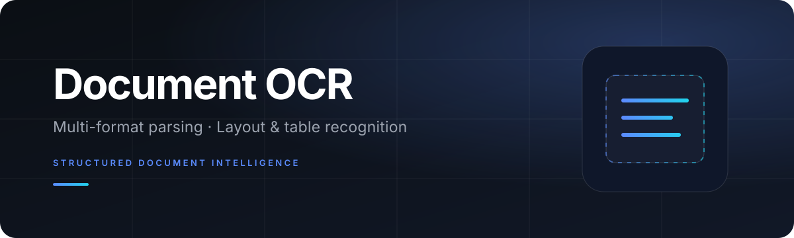
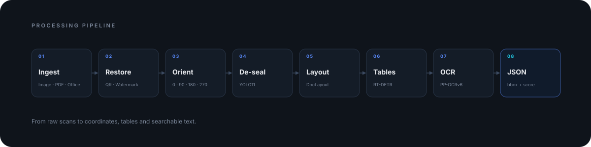
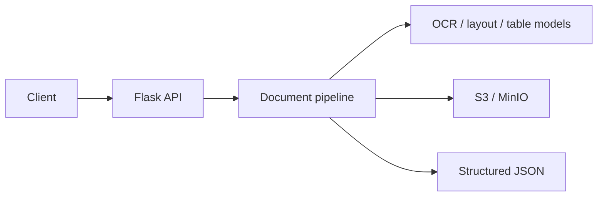

<p align="center">
  
</p>

<p align="center">
  
  
  
  
</p>

<p align="center">
  <strong>Turn documents into structured, searchable data.</strong><br>
  A production-oriented OCR service for images, PDFs and Office files.
</p>

<p align="center">
  <a href="#overview">Overview</a> ·
  <a href="#architecture">Architecture</a> ·
  <a href="#design-notes">Design notes</a> ·
  <a href="#quick-start">Quick start</a> ·
  <a href="#api">API</a>
</p>

## Overview

This service takes scanned or digital documents and returns structured page data:
text lines with character-level bounding boxes, table cells, and seal regions.
It is designed for contract, archive and enterprise document workflows where
layout fidelity matters as much as raw OCR accuracy.

The pipeline handles the unglamorous parts that decide real-world quality:
image restoration, page orientation, watermarks, red seals, headers and footers,
then layout and table analysis before text recognition.

## Architecture

<p align="center">
  
</p>



## Capabilities

| Area | What it does |
|---|---|
| Input | Images, PDF and Office files; optional page ranges |
| Restoration | QR/watermark removal, orientation correction, red seal removal |
| Structure | Layout analysis, table detection, cell OCR, coordinate mapping |
| Output | Character-level bbox + confidence, table cells, seal metadata |
| Operations | Model lazy loading, layout cache, GPU lock, Docker/offline deploy |

## Design notes

### Multi-page watermark removal

Pages are grouped by image size. A pixel is considered a watermark candidate only
when it is consistently dark across at least half of the pages. Background
normalization and OTSU build a per-page mask, and only the intersection of the
vote and the current page mask is painted white. Text and table lines survive.

### Red seal removal

YOLO11 locates seal regions, and a four-way rotation OCR reads the seal text.
Pixel removal works in the R channel with a percentile-based dark-red guard, so
text covered by the seal is preserved instead of being erased together with it.

### Table structure

PP-DocLayoutV2 finds layout regions, RT-DETR detects table cells, and each cell is
recognized independently before its result is mapped back to page coordinates.
When a table has too many cells, the service falls back to text-line OCR to avoid
false table structure.

## Quick start

```bash
python -m venv .venv
source .venv/bin/activate        # Windows: .venv\Scripts\activate
pip install -r requirements.txt
cp .env.example .env
python index.py
```

The service listens on `0.0.0.0:5000` by default.

Key environment variables:

| Variable | Purpose |
|---|---|
| `MODEL_KEY` | Fernet key for an encrypted `models/` directory |
| `STORAGE_MODE` | `proxy` (default) or `minio` |
| `S3_PROXY_SERVER` | Object storage proxy endpoint |
| `MINIO_ENDPOINT` / `MINIO_ACCESS_KEY` / `MINIO_SECRET_KEY` / `MINIO_BUCKET` | MinIO direct mode |
| `SEND_SERVER` | Result image upload service |
| `DEBUG_SAVE_DIR` | Optional debug image output |

## API

### `POST /ocr_process`

```json
{
  "fileType": "imagePdf | office | textPdf | image",
  "taskId": "string",
  "fileKey": "S3 key or HTTP URL",
  "forceImage": true,
  "ignoreSeals": false,
  "ignorePageHeaderAndFooter": false,
  "ignoreContentTable": false,
  "pageRange": [[1, 5], [7, 10]],
  "fileExt": "",
  "detectOrientation": true,
  "removeWatermark": true
}
```

Each page in the response contains `image`, `tables`, `lines`, `red_masks` and
`page`. Lines include per-character boxes and confidence scores.

## Project layout

```text
.
├── index.py                  # Flask entry and pipeline orchestration
├── config.py                 # Model initialization and lazy loading
├── ocr.py                    # Character-level OCR output
├── parse_file_director.py    # Paragraph / page-number filtering
├── s3.py                     # Object storage client
├── cryptor.py                # Model directory encryption utility
├── algo/
│   ├── enhancement/          # Background normalization, watermark voting
│   ├── redmask_remove/       # Seal detection and removal
│   ├── table_detect/         # Table structure recognition
│   ├── header_footer/        # Header / footer handling
│   ├── pdf/                  # PDF rendering and image analysis
│   ├── handwriting/          # Handwriting processing
│   ├── remove_qrcode/        # QR detection
│   └── images_detect/        # Document image similarity
├── Dockerfile
└── requirements.txt
```

## Scope

This repository is a sanitized portfolio snapshot. Client documents, model
weights, internal endpoints and credentials are not included. Model files should
be placed under `models/` or managed with `cryptor.py` and `MODEL_KEY`.

The service is an API, not a UI demo. The code is provided for review and
discussion; please do not use it for unauthorized commercial purposes.
